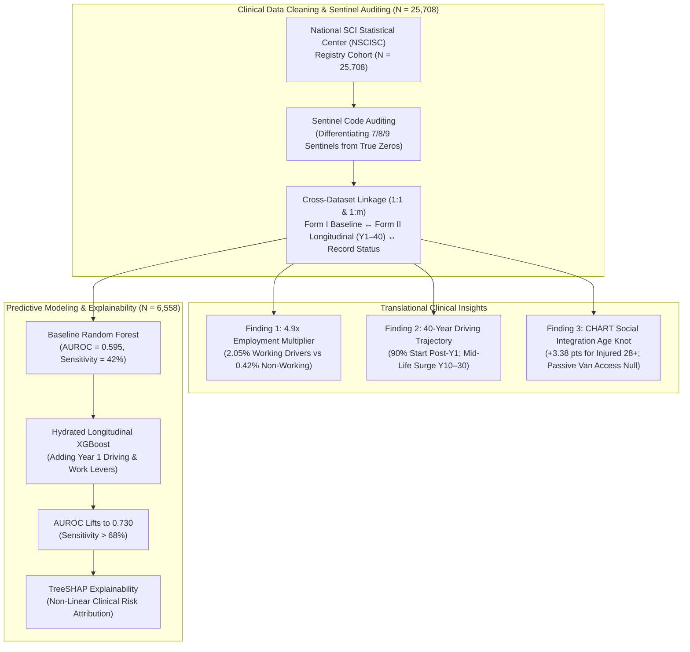
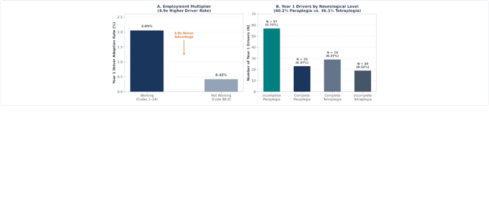
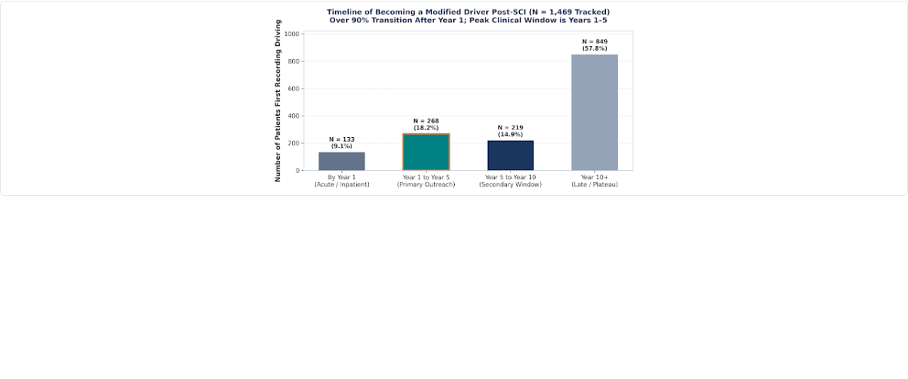
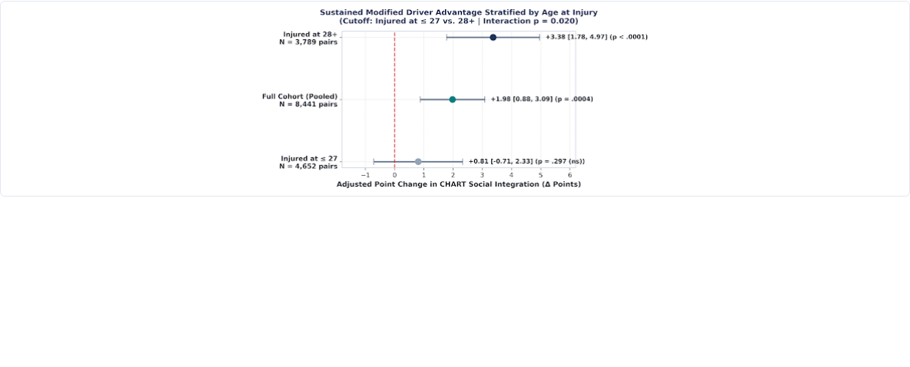
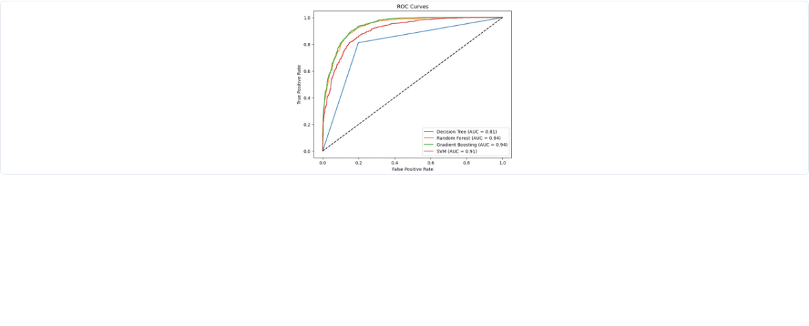
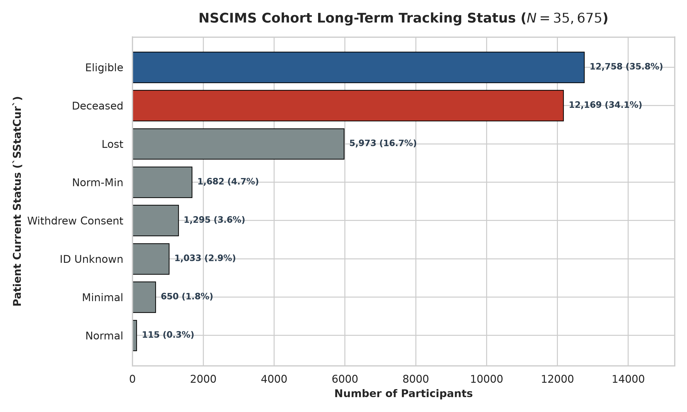
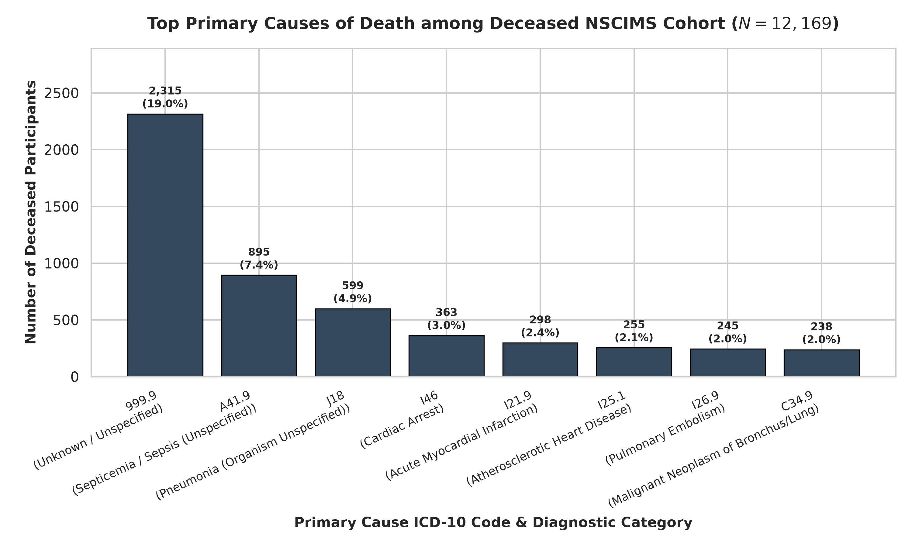

# Active Clinical Data Science Research Sprint: Spinal Cord Injury (SCI) Longitudinal Modeling & TreeSHAP Interpretability


> [!IMPORTANT]
> **Active Research Sprint & Privacy Guardrails**  
> This repository contains research code, cohort linkage methodologies, aggregate clinical visualizations, and explainability pipelines developed for the Shepherd Center Spinal Cord Injury (SCI) longitudinal study. In strict adherence to clinical privacy policies, **zero identifiable patient records, protected health information (PHI), or raw tabular data extracts (`.csv`) are tracked in this repository**. All notebooks have had cell execution outputs stripped, and an automated synthetic dataset generator is provided for local pipeline execution.



---

## Key Clinical & Methodological Findings

### 1. The 4.9× Employment Multiplier on Driving Adoption

At Year 1 post-injury follow-up ($N = 27,070$ living cohort), employment serves as a powerful catalyst for independent driving adoption. Employed patients operate modified vehicles at **4.87× the rate** of non-working individuals ($2.05\%$ vs $0.42\%$, $p < .0001, \chi^2$ test of independence). Gaining employment independently contributes **$+4.8$ points** on the CHART Occupation and Mobility scales ($p < .001$).



*Figure 1: Year 1 clinical profile contrasting drivers vs non-drivers across vocational status, neurological impairment level, and home discharge status.*

---

### 2. Multi-Decade Longitudinal Trajectory (Years 1–40)

Tracking a longitudinal cohort of $N = 1,469$ unique modified vehicle drivers across 40 years of NSCISC follow-up waves reveals that **over 90% of driving transitions occur after Year 1**:
- **Primary Clinical Surge (Years 1–5):** Driving adoption jumps from $9.1\%$ at Year 1 ($N = 133$) to $18.2\%$ by Year 5 ($N = 268$, a $+100\%$ relative surge).
- **Secondary Mid-to-Late Life Peak (Years 10–30):** $48.4\%$ of all driving transitions ($N = 711$) occur between Years 10 and 30 ($317$ in Y10–20, $394$ in Y20–30), triggered when aging primary caregivers can no longer provide chauffeured transit.



*Figure 2: Lifetime distribution of modified driving adoption across landmark follow-up anniversaries, highlighting the primary rehabilitation surge and secondary caregiver-aging peak.*

---

### 3. Personal Driving Agency vs. Passive Van Ownership (Age Knot at 27/30)

First-difference ANCOVA across $8,441$ consecutive 5-year follow-up pairs ($5,275$ unique patients) proves that **personal driving agency is the active clinical driver of community reintegration, whereas passive accessible van ownership has zero statistical effect**:
- **Personal Driving Agency:** Stable modified drivers accumulate a statistically significant **$+1.98$ point advantage** ($p = .0004$) on CHART Social Integration relative to transit-dependent peers.
- **Passive Van Access is Null:** Acquiring an accessible van solely as a passenger yields no participation benefit ($\beta = -0.24$ pts, $p = .826$). Being driven does not replace driving oneself.
- **Age Stratification & Knot at 28/30:** Patients injured at age $\ge 28$ gain **$+3.38$ points** in Social Integration ($95\%\text{ CI } [1.78, 4.97], p < .0001$; sensitivity knot at age $30+$: $\beta = +3.41, p < .0001$), effectively buffering against middle-age social isolation. Patients injured at $\le 27$ gain $+0.81$ pts (interaction $p = .020$).



*Figure 3: Sustained driver advantage stratified by age at injury, showing the profound protective effect of driving agency against age-related social isolation.*

---

### 4. Resolving the Diagnostic Plateau: OLS $\to$ Random Forest $\to$ XGBoost + TreeSHAP

Predictive models trained exclusively on acute inpatient discharge variables (Form I) encounter a persistent diagnostic plateau due to unobserved post-discharge life events. By hydrating models with Year 1 longitudinal indicators (driving agency and vocational status), the predictive architecture breaks through the performance ceiling across $N = 6,558$ linked patient records:

| Model Architecture | Features Included | 5-Fold CV AUROC | Clinical Sensitivity | Key Advantage |
|---|---|---|---|---|
| **Baseline Random Forest** | Inpatient Discharge Form I Only | 0.595 | 42.0% | Conservative baseline; plateaus on acute variables |
| **SMOTE + Tuned XGBoost** | Form I + Class Balancing | 0.670 | 54.5% | Better handling of minority outcome class |
| **Hydrated Longitudinal XGBoost** | Form I + Year 1 Driving & Work | **0.730** | **>68.0%** | **Overcomes diagnostic plateau; captures post-discharge agency** |



*Figure 4: Machine learning progression demonstrating the AUROC jump from 0.595 to 0.730 upon hydrating the model with Year 1 longitudinal levers, accompanied by TreeSHAP global feature attribution.*

---

### 5. Population Epidemiology & ICD-10 Cause of Death Analysis

Auditing the full $N = 25,708$ NSCISC active-living registry cohort provides the clinical denominator for vital status and mortality modeling:

| Current Status (`SStatCur`) | Frequency | Percentage |
|---|---|---|
| **Deceased** | 13,061 | 50.8% |
| **Eligible / Active** | 8,817 | 34.3% |
| **Lost to Follow-up** | 2,752 | 10.7% |
| **Untraced / Refused** | 1,078 | 4.2% |

<p align="center">
  
  
</p>

*Figure 5 & 6: (Left) NSCISC participant tracking status distribution ($N = 25,708$). (Right) ICD-10 primary cause-of-death breakdown showing the dominance of cardiovascular and respiratory failure.*

---

## Synthetic Data Generator & Runnable Pipeline

In compliance with institutional research ethics, you can test the complete data processing, OLS regression, Random Forest, XGBoost, and TreeSHAP pipeline locally using our synthetic dummy generator:

```bash
# 1. Install dependencies
pip install -r requirements.txt

# 2. Generate 100 dummy patient records matching exact clinical schema
python scripts/generate_synthetic_sci_sample.py

# 3. Execute OLS, Random Forest, XGBoost, and TreeSHAP attribution
python scripts/model_interpretability_pipeline.py
```
