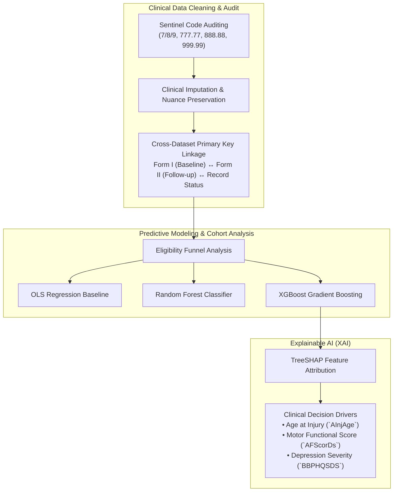

# Active Clinical Data Science Research Sprint: Spinal Cord Injury (SCI) Longitudinal Modeling & TreeSHAP Interpretability


> [!IMPORTANT]
> **Active Research Sprint & Privacy Guardrails**  
> This repository contains research code, cohort linkage methodologies, and explainability pipelines developed for the Shepherd Center Spinal Cord Injury (SCI) longitudinal study. In strict adherence to clinical privacy policies, **zero identifiable patient records, protected health information (PHI), or raw tabular extracts (`.csv`) are tracked in this repository**. All notebooks have had execution table outputs stripped, and an automated synthetic dataset generator is provided for local pipeline execution.



---

## Research Sprint Focus

### 1. Longitudinal Cohort Construction & Eligibility Funnel
- Audits multi-decade participant retention across **Form I** (acute rehabilitation baseline), **Form II** (longitudinal post-discharge follow-up at 1, 5, 10, 15, and 20 years), and **Record Status** tracking.
- Tracks patient status transitions (`SStatCur`: Active Eligible vs Lost to Follow-up vs Deceased).

### 2. Sentinel Code Missingness Auditing
- Clinical datasets utilize specialized numeric sentinel codes (7 = not applicable, 8 = missing, 9 = unknown, alongside decimal patterns such as `888.8` = patient alive vs `999.9` = unknown cause of death).
- Developed automated detection algorithms to differentiate true clinical zeros from administrative sentinel values without biasing risk ratios.

### 3. ICD-10 Cause of Death Categorization
- Translates specific ICD-10 mortality codes into six macro organ-system categories (Cardiovascular, Respiratory, Septicemia, External Causes, etc.) to analyze long-term health trajectory correlations.

### 4. Machine Learning & TreeSHAP Interpretability Pipeline
- Benchmarks **OLS linear/logistic regressions**, **Random Forest**, and **XGBoost**.
- Uses **TreeSHAP** (Tree-based Shapley Additive exPlanations) to measure localized and global feature attribution for mortality and community reintegration risk factors.

---

## Testing the Pipeline with Synthetic Data

Generate a 100-row dummy dataset matching the exact clinical feature schema and run the modeling pipeline:

```bash
# 1. Install dependencies
pip install -r requirements.txt

# 2. Generate dummy schema dataset
python scripts/generate_synthetic_sci_sample.py

# 3. Run OLS, Random Forest, XGBoost, and TreeSHAP
python scripts/model_interpretability_pipeline.py
```
